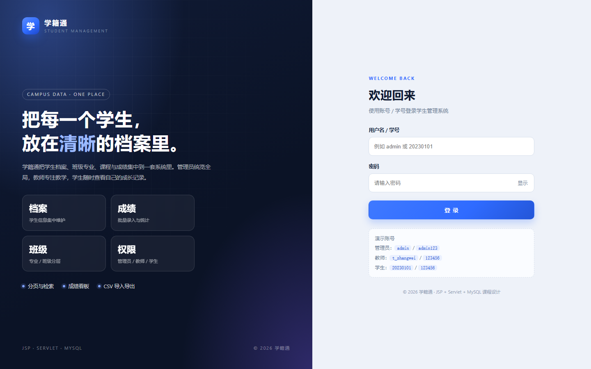
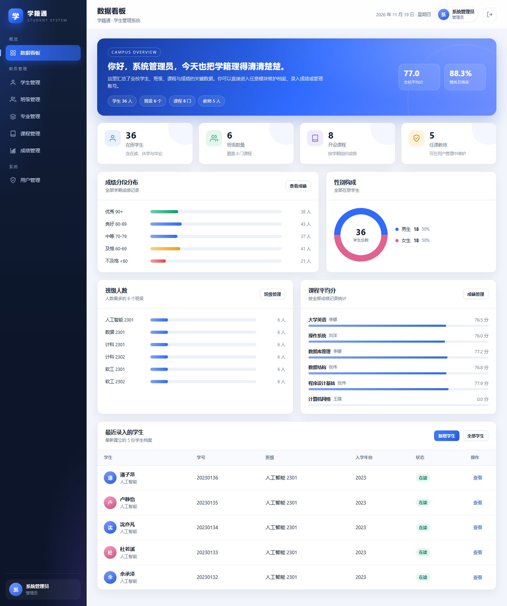
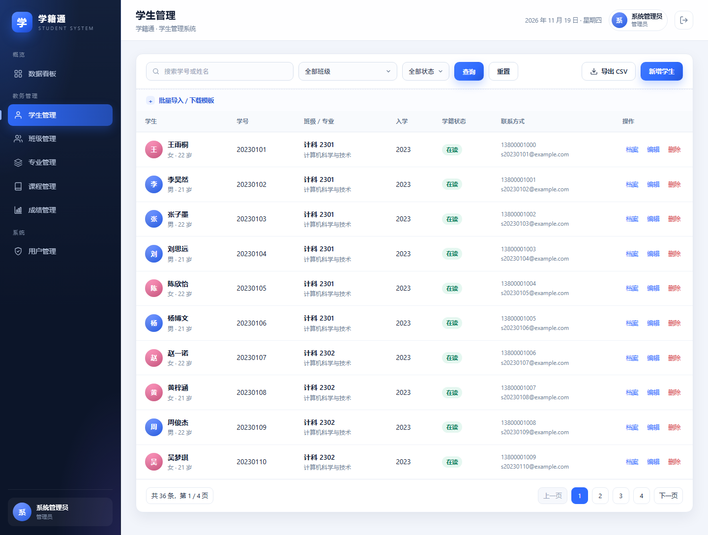
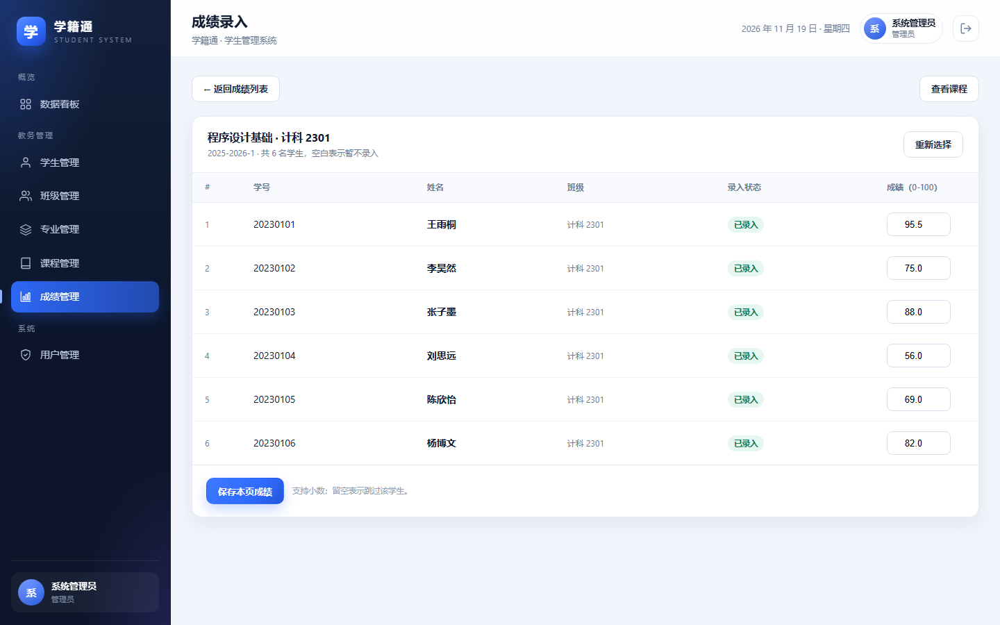
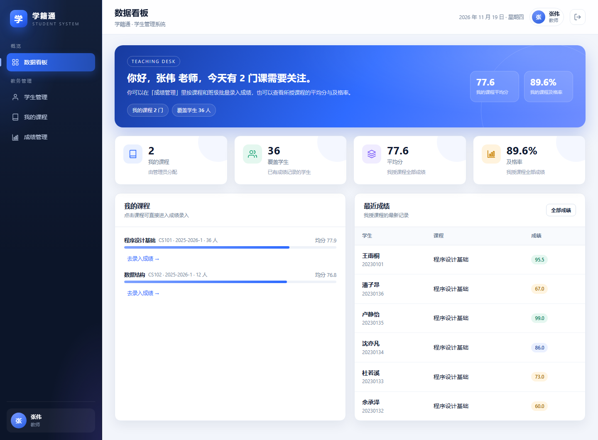
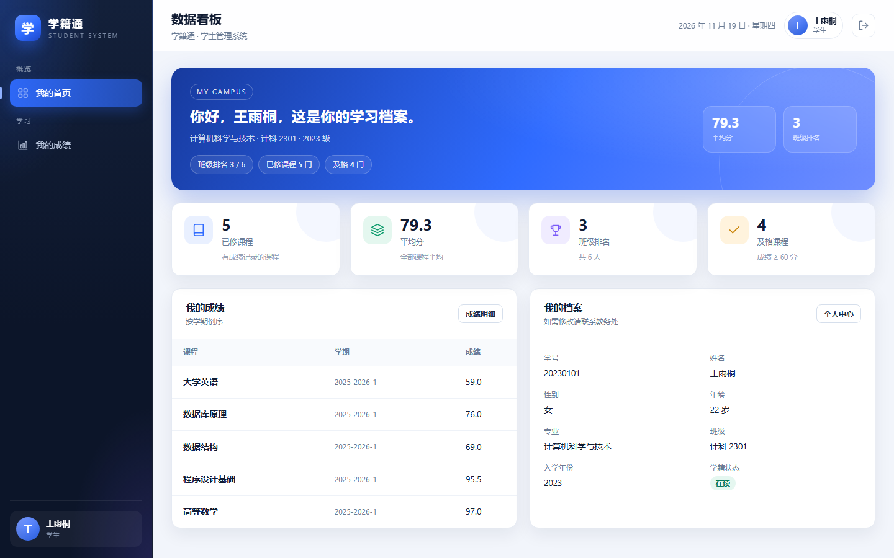

# 学籍通 · 学生管理系统

一个用 **JSP + Servlet + JDBC + MySQL** 实现的学生管理系统，按「管理员 / 教师 / 学生」三种角色划分权限。包含学生档案、班级专业、课程、成绩、用户账号、数据看板，以及 CSV 导入导出。

> 课程设计项目 · 可直接在 **IntelliJ IDEA（Ultimate）** 或 **Eclipse（Enterprise Java and Web Developers 版）** 中打开，配合 **Tomcat 9** 运行。

---

## 界面预览

### 登录页


### 管理员 · 数据看板


### 学生管理


### 成绩录入


### 教师看板


### 学生看板


---

## 功能一览

| 模块 | 功能 |
| --- | --- |
| 登录 / 退出 | Session 登录、PBKDF2 加盐密码、登录拦截、按角色隔离模块 |
| 数据看板 | 学生 / 班级 / 课程 / 教师统计、成绩分段、性别构成、班级人数、课程平均分 |
| 学生管理 | 增删改查、分页、按姓名 / 学号 / 班级 / 学籍状态筛选、学生档案、CSV 导入导出、导入模板 |
| 班级管理 | 增删改查、所属专业、年级、班主任、班级人数；有学生时禁止删除 |
| 专业管理 | 增删改查、班级数 / 学生数统计；有班级时禁止删除 |
| 课程管理 | 增删改查、学分学时、任课教师、开课学期；有成绩时禁止删除 |
| 成绩管理 | 按课程 / 班级 / 学期 / 关键字查询、批量录入（支持小数、回车跳格）、删除、课程平均分与及格率 |
| 用户管理 | 账号增删改查、角色、启用 / 停用、重置密码为 123456、最后登录时间 |
| 个人中心 | 查看资料、修改手机 / 邮箱、修改密码 |
| 学生视角 | 我的首页、我的成绩（平均分、班级排名、及格数） |

### 权限矩阵

| 功能 | 管理员 | 教师 | 学生 |
| --- | :---: | :---: | :---: |
| 数据看板 | 全校 | 自己课程 | 个人 |
| 学生列表 / 档案 | 查看 + 维护 | 只读 | — |
| 班级 / 专业 | 维护 | 班级只读 | — |
| 课程 | 维护 | 只读（自己的课） | — |
| 成绩 | 全部维护 | 只维护自己课程 | 只看自己的 |
| 用户管理 | ✔ | — | — |
| 个人中心 | ✔ | ✔ | ✔ |

---

## 技术栈

- Java 17 源码级别（本机用 JDK 25 编译、Tomcat 9.0.30 实测可运行）
- JSP 2.3 / Servlet 4.0（`javax.servlet`，对应 **Tomcat 9**）
- JSTL 1.2（`jstl-1.2.jar`）
- MySQL 8.0 + `mysql-connector-j-8.0.33.jar`
- 原生 JDBC + DAO 分层，不依赖 Spring / Maven / 连接池
- 手写 CSS + 原生 JS，不依赖任何 CDN，断网也能正常显示

> ⚠️ 本项目使用 `javax.servlet`，请使用 **Tomcat 9.x**。Tomcat 10+ 改成了 `jakarta.servlet`，直接部署会报 `ClassNotFoundException`。

---

## 目录结构

```text
StudentMS/
├── src/
│   ├── db.properties                 # 数据库连接配置（改这里）
│   └── com/sms/
│       ├── entity/                   # User / Student / Clazz / Major / Course / Score / Page / StatItem / CourseStat / ScoreEntry
│       ├── dao/                      # UserDao / StudentDao / ClazzDao / MajorDao / CourseDao / ScoreDao / DashboardDao
│       ├── servlet/                  # 登录 / 看板 / 学生 / 班级 / 专业 / 课程 / 成绩 / 用户 / 个人中心
│       ├── filter/                   # EncodingFilter / AuthFilter
│       └── util/                     # DBUtil / PasswordUtil / CsvUtil / WebUtil / Constants
├── WebContent/
│   ├── login.jsp                     # 登录页
│   ├── index.jsp                     # 入口跳转
│   ├── error.jsp                     # 403 / 404 / 500 错误页
│   ├── assets/css/app.css            # 全部手写样式
│   ├── assets/js/app.js              # 侧栏、确认框、提示条等交互
│   └── WEB-INF/
│       ├── web.xml                   # Filter / Servlet / 错误页注册
│       ├── views/                    # 登录后的页面（不可直接访问）
│       │   ├── dashboard.jsp
│       │   ├── student-list.jsp / student-form.jsp / student-detail.jsp
│       │   ├── clazz-list.jsp / clazz-form.jsp
│       │   ├── major-list.jsp
│       │   ├── course-list.jsp / course-form.jsp
│       │   ├── score-list.jsp / score-entry.jsp / score-my.jsp
│       │   ├── user-list.jsp / user-form.jsp
│       │   ├── profile.jsp
│       │   └── common/               # sidebar / topbar / flash
│       └── lib/
│           ├── jstl-1.2.jar
│           └── mysql-connector-j-8.0.33.jar
├── sql/student_ms.sql                # 建库、建表、演示数据、专用账号
├── lib/servlet-api.jar               # 仅供编译，不部署到 WEB-INF/lib
├── docs/screenshots/                 # 界面截图
├── .project / .classpath / .settings # Eclipse 工程配置
├── .idea / StudentMS.iml             # IntelliJ IDEA 工程配置（含 Tomcat 运行配置）
└── README.md
```

---

## 快速开始

### 1. 准备环境

| 软件 | 版本 | 说明 |
| --- | --- | --- |
| JDK | 17 及以上 | 本机已装 JDK 25，可直接用 |
| IntelliJ IDEA | 2026.2 Ultimate（本机已装） | 运行配置已随项目提供；社区版不支持 Tomcat |
| Eclipse | Enterprise Java and Web Developers 版 | 需要 WTP（Dynamic Web Project），可选 |
| Tomcat | 9.x | 本机：`D:\apache-tomcat-9.0.30-windows-x\apache-tomcat-9.0.30` |
| MySQL | 8.0 | 本机 MySQL80 服务已启动 |

### 2. 初始化数据库

本机已经执行过脚本，数据库 `student_ms` 和演示数据都在。如果换电脑或想重置数据，用 **root** 执行：

```bash
mysql -uroot -p --default-character-set=utf8mb4 < sql/student_ms.sql
```

脚本会：

1. 创建 `student_ms` 数据库（utf8mb4）；
2. 创建 `sys_user`、`major`、`clazz`、`student`、`course`、`score` 六张表；
3. 写入 4 个专业、6 个班级、5 名教师、36 名学生、8 门课程、180 条成绩；
4. 创建项目专用账号 `sms_app`，密码 `sms123456`，只授予本库权限。

> 脚本开头有 `DROP DATABASE IF EXISTS student_ms`，**重复执行会清空旧数据**。
> 不想用专用账号时，可以删掉脚本末尾的 `CREATE USER / GRANT`，再把 root 账号填进 `src/db.properties`。

### 3. 在 Eclipse 中导入运行

#### 3.1 配置 Tomcat 运行时

1. 打开 Eclipse：`Window → Preferences → Server → Runtime Environments → Add…`；
2. 选择 **Apache Tomcat v9.0**；
3. `Tomcat installation directory` 选择 `D:\apache-tomcat-9.0.30-windows-x\apache-tomcat-9.0.30`；
4. `JRE` 选择本机 JDK（JDK 25 即可），`Finish`。

#### 3.2 导入项目

1. `File → Import… → General → Existing Projects into Workspace`；
2. `Select root directory` 选择 `C:\Users\Andersen\Desktop\jspweb\StudentMS`；
3. 勾选 `StudentMS`，`Finish`；
4. 导入后如提示编码，确认项目编码为 **UTF-8**（工程已带 `.settings/org.eclipse.core.resources.prefs`）。

#### 3.3 绑定运行时并启动

1. 右键项目 → `Properties → Targeted Runtimes`，勾选 **Apache Tomcat v9.0**；
2. 确认 `Properties → Project Facets`：`Dynamic Web Module 4.0`、`Java 17`；
3. 右键项目 → `Run As → Run on Server` → 选择 Tomcat v9.0 → `Finish`；
4. 浏览器访问：<http://localhost:8080/studentms/>。

> 部署上下文在 `.settings/org.eclipse.wst.common.component` 里固定为 `/studentms`。
> 如果 8080 被占用，先在 `Servers` 视图里双击 Tomcat，把 HTTP 端口改成 8081 等，再访问 `http://localhost:8081/studentms/`。

#### 3.4 如果 Eclipse 报错

| 现象 | 处理 |
| --- | --- |
| 项目上有红叉，`javax.servlet` 找不到 | `Properties → Targeted Runtimes` 勾选 Tomcat 9；或 `Build Path → Add Library → Server Runtime` |
| `Targeted runtime Apache Tomcat v9.0 is not defined` | 先做 3.1 添加运行时，再刷新项目 |
| JSP 中文乱码 | 确认 `Window → Preferences → General → Workspace → Text file encoding = UTF-8`，并刷新/清理项目 |
| 启动报 `ClassNotFoundException: com.mysql.cj.jdbc.Driver` | 确认 `WebContent/WEB-INF/lib` 下有 `mysql-connector-j-8.0.33.jar`，Project → Clean |
| 页面报 500 / 数据库连接失败 | 确认 MySQL 服务启动；检查 `src/db.properties` 的地址、账号、密码 |

### 4. 在 IntelliJ IDEA 中打开（本机已配置）

本机安装的是 **IntelliJ IDEA 2026.2 Ultimate**，Tomcat 9.0.30 也已在 IDE 里配置过，项目自带 `.idea`，可以直接打开运行：

1. 打开 IDEA → `File → Open…`，选择 `C:\Users\Andersen\Desktop\jspweb\StudentMS`，提示时选 **Trust Project**；
2. 等索引完成。项目 SDK 已设为 `ms-25`（Microsoft JDK 25）；如果提示 SDK 无效，`File → Project Structure → Project SDK` 选本机 JDK 17/25；
3. 右上角运行配置选择 **Tomcat 9.0.30**，点绿色 Run；
4. 浏览器访问 <http://localhost:8080/studentms/>。

已配置好的内容：

- Web facet：Web 根目录 `WebContent`，部署描述符 `WebContent/WEB-INF/web.xml`；
- Artifact：`StudentMS:Web exploded`，输出到 `out/artifacts/StudentMS_Web_exploded`；
- Tomcat 运行配置上下文 `/studentms`，启动后自动打开首页；
- 依赖：`lib/servlet-api.jar`、`jstl-1.2.jar`、`mysql-connector-j-8.0.33.jar` 都已加入模块依赖。

如果运行配置报错：

| 现象 | 处理 |
| --- | --- |
| `Application server is not configured` | `Settings → Build, Execution, Deployment → Application Servers → +`，选 Tomcat Server，目录指向 `D:\apache-tomcat-9.0.30-windows-x\apache-tomcat-9.0.30` |
| Artifact 一栏是红色 | `File → Project Structure → Artifacts`，删除后重新添加 `Web Application: Exploded → From Module 'StudentMS'` |
| 端口 8080 被占用 | `Run → Edit Configurations → Tomcat 9.0.30 → Server`，把 HTTP port 改成 8081 |
| 页面 500 / 数据库连不上 | 确认 MySQL80 服务启动，检查 `src/db.properties` |

> IDEA **社区版**没有 Tomcat / Java EE 支持，请用 Ultimate，或改用 Eclipse。

---

## 演示账号

| 角色 | 账号 | 密码 | 说明 |
| --- | --- | --- | --- |
| 管理员 | `admin` | `admin123` | 全部功能 |
| 教师 | `t_zhangwei` | `123456` | 张伟，教「程序设计基础」「数据结构」 |
| 教师 | `t_lina` | `123456` | 李娜，教「数据库原理」「大学英语」 |
| 学生 | `20230101` | `123456` | 王雨桐，计科 2301 |
| 学生 | `20230107` | `123456` | 赵一诺，计科 2302 |

> 新增学生时系统会自动开通账号：**用户名 = 学号，初始密码 123456**。
> 教师 / 管理员账号在「用户管理」中创建。

---

## 页面与路由

| 路径 | 说明 | 可访问角色 |
| --- | --- | --- |
| `/login.jsp` | 登录页 | 所有人 |
| `POST /login` | 登录 | 所有人 |
| `/logout` | 退出登录 | 已登录 |
| `/dashboard` | 数据看板（按角色显示不同内容） | 全部 |
| `/student` | 学生列表（`keyword` / `clazzId` / `status` / `page`） | 管理员、教师 |
| `/student?action=toAdd`、`toEdit&id=` | 新增 / 编辑学生 | 管理员 |
| `/student?action=detail&id=` | 学生档案 | 管理员、教师 |
| `/student?action=export` | 导出 CSV | 管理员、教师 |
| `/student?action=template` | 下载导入模板 | 管理员 |
| `POST /student` `action=import` | CSV 批量导入 | 管理员 |
| `/clazz`、`/major` | 班级 / 专业 | 管理员（教师可看班级） |
| `/course` | 课程列表 | 管理员、教师 |
| `/score` | 成绩列表 | 管理员、教师 |
| `/score?action=entry` | 成绩录入（选课程 / 班级 / 学期） | 管理员、教师 |
| `/score?action=my` | 我的成绩 | 学生 |
| `/user` | 用户管理 | 管理员 |
| `/profile` | 个人中心 | 全部 |

---

## 数据库设计

```text
sys_user 1 ──< student (user_id)        登录账号与学生档案一对一
major    1 ──< clazz   (major_id)
clazz    1 ──< student (clazz_id)
sys_user 1 ──< clazz   (head_teacher_id 班主任)
sys_user 1 ──< course  (teacher_id 任课教师)
student  1 ──< score   (student_id)
course   1 ──< score   (course_id)
score 唯一键 (student_id, course_id, term)
```

- 密码字段保存 `pbkdf2_sha256$迭代次数$Base64盐$Base64哈希`，不保存明文。
- 所有 SQL 使用 `PreparedStatement`，排序字段不拼接用户输入。
- 外键：删除学生级联删除成绩；删除班级 / 专业 / 课程前在业务层做占用检查。

### CSV 导入格式

第一行是表头，从第二行开始读取，列顺序固定：

```text
学号,姓名,性别,出生日期,班级代码,入学年份,学籍状态,手机,邮箱,家庭住址
20230999,张三,男,2005-06-01,JZ2301,2023,在读,13800000000,zhangsan@example.com,浙江省杭州市
```

- 学号已存在时更新档案，不存在时新建（同时创建登录账号）；
- 班级代码必须已在班级管理中存在，否则该行失败；
- 导入结束会提示成功 / 失败条数和前几条失败原因；
- 导出的 CSV 带 UTF-8 BOM，Excel 双击可直接打开。

---

## 实现要点

- **为什么用 `web.xml` 注册 Servlet**：Tomcat 9.0.30 较旧，配合 JDK 25 时注解扫描可能读不懂高版本 class 文件；本项目全部显式注册并设置 `metadata-complete="true"`，部署更稳。
- **分页**：`Page<T>` 统一封装总数、页码、上一页 / 下一页，所有列表统一每页 10 条。
- **种子密码**：`PasswordUtil` 生成 PBKDF2 哈希后写进 SQL 脚本，登录时按同样算法校验。
- **编码**：`EncodingFilter` + JSP `page-encoding` + 数据库 `utf8mb4` + Eclipse 项目编码 UTF-8。
- **图表**：成绩分布、班级人数、课程平均分都用 CSS 条形图实现，不依赖 ECharts 等 CDN。

---

## 已知限制

- 课程设计级别，未接入连接池（每次请求新建连接），高并发场景应改用 HikariCP / Druid。
- 未接入 CSRF Token、操作审计日志。
- CSV 导入为逐行处理，不做整批事务回滚。
- 成绩录入按「一个班级 + 一门课 + 一个学期」整页提交，单页人数很多时需要分页处理（当前按班级整页显示）。

---

## 项目介绍 PPT

[学籍通-学生管理系统-项目介绍.pptx](docs/学籍通-学生管理系统-项目介绍.pptx)

---

## 常用命令

```bash
# 重新导入数据库（会清空现有数据）
mysql -uroot -p --default-character-set=utf8mb4 < sql/student_ms.sql

# 生成一个新的密码哈希（可选）
javac -encoding UTF-8 -d build/classes src/com/sms/util/PasswordUtil.java
java -cp build/classes com.sms.util.PasswordUtil 你的新密码
```
